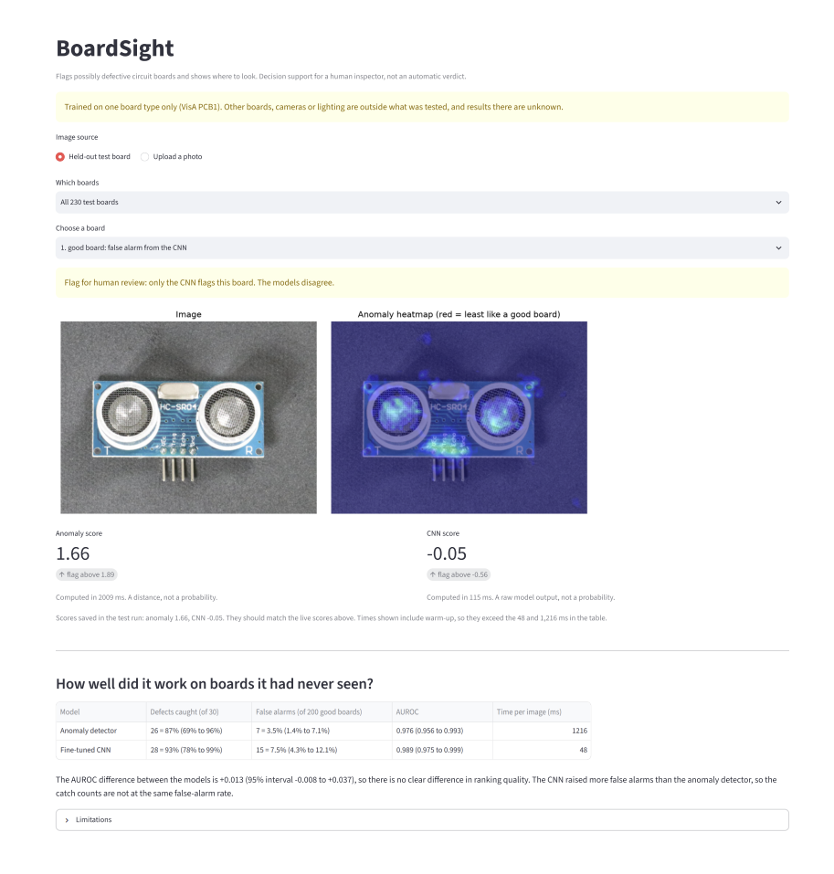
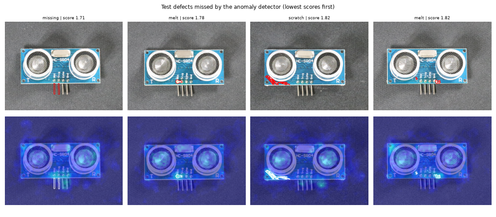
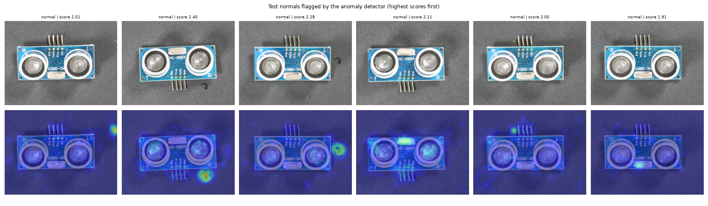

# BoardSight

**Anomaly detection against a fine-tuned CNN for finding defects on printed circuit boards: when does supervision help?**

BoardSight inspects a photo of a circuit board, flags it for human review if it looks defective, and shows where to look. It compares two ways of doing this on the same images:

- **Model A, anomaly detector:** learns only from good boards. A pretrained network's patch features from good boards are stored in a memory bank, and a new board is scored by how far its patches are from the nearest stored good patch. It needs no defect labels and produces a heatmap.
- **Model B, supervised CNN:** a pretrained ResNet18 fine-tuned on labelled good and defective boards.

The point of the project is the comparison and its honesty. All numbers below were produced by the code in this repository, on a fixed split, with decisions recorded before the held-out test set was scored.

**Demo video (2 min):** https://youtu.be/LbkxZ0CP5Ws



## Contents

1. [Summary of findings](#summary-of-findings)
2. [The question](#the-question)
3. [Data](#data)
4. [Methods](#methods)
5. [Experiments and results](#experiments-and-results)
6. [Held-out test results](#held-out-test-results)
7. [Failure analysis](#failure-analysis)
8. [Process and honesty](#process-and-honesty)
9. [Limitations](#limitations)
10. [The app](#the-app)
11. [Getting started](#getting-started)
12. [Reproducing the results](#reproducing-the-results)
13. [Repository structure](#repository-structure)
14. [Future work](#future-work)
15. [Data licence, tech stack and author](#data-licence-tech-stack-and-author)

## Summary of findings

All results are for one board type (VisA PCB1) and come with the intervals shown in the sections below.

- **With about 56 to 70 labelled defects, a fine-tuned CNN and a tuned anomaly detector that never sees a defect label performed about equally.** On 30 held-out defective and 200 good boards, AUROC was 0.989 for the CNN and 0.976 for the anomaly detector. The paired difference was +0.013 (95% interval -0.008 to +0.037), which includes zero.
- **The detector needs no defect labels at all, while the CNN needed many.** Trained with 5 or 10 defective examples, the CNN was clearly worse than the detector (AUROC about 0.91 against 0.99). With 25 it was not clearly different, and with all 56 it matched the detector.
- **Resolution mattered more than anything else for the detector.** The median defect covers only 0.2% of the image. At 192 x 256 pixels the detector's validation AUROC was about 0.91, and at 384 x 512 it was 0.99.
- **The anomaly heatmap points at the defect; Grad-CAM did not.** For the strongest peak to land on or near the true defect, the anomaly heatmap succeeded on 96% of development defects, against 27% to 43% for Grad-CAM, whose cells are about as large as a typical defect.
- **The CNN is about 25 times faster per image on a laptop CPU** (48 ms against 1,216 ms, image loading included).
- **Some things did not transfer.** A threshold set for 90% recall on development defects caught only 77% of held-out defects. A first plan for the CNN's threshold failed its own check and was replaced before the test run.
- **Where it fails:** the four missed test defects were all small and in the lower half of the board, and two of the worst false alarms were caused by marks on the background, not by the board.

## The question

In factories, good boards are plentiful and defective ones are rare. This project asks, with about 1,000 good boards and only 100 defective ones:

1. When does supervision help? How many labelled defects does a CNN need before it catches up with an anomaly detector trained on good boards only?
2. Does a CNN catch defect types it has never seen?
3. Where does each method say the defect is, and how sharp is that evidence?
4. What do these models cost in time and memory on an ordinary laptop?

The plan, the experiments and the evaluation rules were written to `eval/DECISIONS.md` as the work progressed, before each result was seen.

## Data

**VisA, subset PCB1** (Zou et al., 2022): photographs of one type of small circuit board, 1,404 x 1,070 pixels.

| | Images |
|---|---|
| Good boards | 1,004 |
| Defective boards | 100 |

- **Defect types:** melt, missing, bent and scratch. 91 defective images carry one type and 9 carry two or three. The images contain each type as follows: melt 54, scratch 21, missing 20, bent 15.
- **Defects are tiny.** Defect area as a share of the image: median 0.198%, quartiles 0.152% to 0.311%, minimum 0.077%, maximum 12.7%. At 288 x 384 pixels the median defect is about 15 x 15 pixels.
- Every defective image has a pixel mask, and no good image has one.

**Split** (fixed with seed 0 before any model ran, in `eval/split_pcb1.csv`):

| Role | Images | Used for |
|---|---|---|
| train_normal | 604 | Training both models |
| val_normal | 200 | Choosing settings and thresholds |
| test_normal | 200 | Final test, scored once |
| dev_defect | 70 | Training the CNN (in folds), choosing settings |
| test_defect | 30 | Final test, scored once (4 to 14 per defect type) |

## Methods

**Anomaly detector (Model A).**
- Features come from layers 2 and 3 of a pretrained ResNet18 (384 numbers per patch), each smoothed over a 3 x 3 neighbourhood.
- A random subset of all patches of the good training boards forms the memory bank. The final bank holds 92,774 patches (143 MB).
- A patch's score is its distance to the nearest bank patch. The board's score is the largest patch distance, and the patch distances form the heatmap.
- Final settings: 384 x 512 pixels, 5% of patches kept, seed 0. It uses no defect images in training, but its settings were chosen on development defects.

**Supervised CNN (Model B).**
- ResNet18 with ImageNet weights, new one-output layer, 288 x 384 input.
- AdamW (learning rate 1e-4, weight decay 1e-4), batch size 16, 6 epochs, loss weighted by the ratio of good to defective images, random shifts of up to 8 pixels and about 10% brightness jitter.
- These settings were fixed before training and not tuned. Training runs on the CPU.

**Whole-image baseline.** A ResNet18 turns each image into 512 numbers, and the score is the distance to the nearest good training image. It cannot show where a defect is.

**Thresholds.** The decision threshold of each model is the 95th percentile of its scores on the 200 validation good boards, so about 5% of good boards are flagged. An image is flagged if its score is strictly above it. The scores are a distance and a raw network output, and neither is a probability.

## Experiments and results

All numbers in this section use only the development data: the 200 validation good boards and the 70 development defects. The test set is not touched here.

### Baseline against the anomaly detector (validation)

| Method | AUROC | melt | missing | bent | scratch |
|---|---|---|---|---|---|
| Whole-image baseline | 0.913 | 0.856 | 0.992 | 0.964 | 0.939 |
| Anomaly detector, default (288 x 384, 5%) | 0.976 (95% 0.959 to 0.989) | 0.970 | 0.988 | 0.999 | 0.961 |

Per-type AUROCs use 10 to 37 images, so they are noisy.

### Fair comparison: 5-fold cross-validation (E1)

The CNN needs defective images for training, and each image can be used only once. So the 70 development defects were split into 5 folds stratified by type. For each fold, the CNN trained on the good training boards and the other four folds and was scored on the held-out fold plus the 200 validation good boards. The anomaly detector was scored on the same images.

| | Mean AUROC over 5 folds | Difference, CNN minus detector (95% paired bootstrap) |
|---|---|---|
| CNN, 56 labelled defects | 0.992 | |
| Anomaly detector, default settings | 0.976 | +0.016 (+0.003 to +0.031) |
| Anomaly detector, final settings (384 x 512) | 0.991 | +0.001 (-0.009 to +0.010) |

The CNN looked better until the anomaly detector was tuned. The tuning gave the detector an advantage the CNN did not get: the detector had a resolution sweep and the CNN stayed at 288 x 384 with fixed settings.

At fixed operating points on the held-out folds (mean, with the range over folds):

| Model | False alarms at 90% recall | Defects missed at 5% false alarms |
|---|---|---|
| CNN | 3.1% (1.0% to 11.5%) | 2.9% (0.0% to 14.3%) |
| Anomaly detector, default | 7.8% (2.0% to 12.0%) | 18.6% (0.0% to 35.7%) |
| Anomaly detector, final | 2.5% (0.5% to 6.0%) | 7.1% (0.0% to 14.3%) |

With about 14 defects per fold, one defect is 7 percentage points.

### How many labels does the CNN need? (E3)

The CNN trained with a random subset of the defects outside each held-out fold (one subset per setting, so the curve is noisy).

| Labelled defects used | CNN | Detector (final) | Difference | 95% interval |
|---|---|---|---|---|
| 5 | 0.912 | 0.991 | -0.080 | -0.118 to -0.051 |
| 10 | 0.917 | 0.991 | -0.074 | -0.115 to -0.037 |
| 25 | 0.976 | 0.991 | -0.015 | -0.044 to +0.005 |
| 56 (all) | 0.992 | 0.991 | +0.001 | -0.009 to +0.010 |

The CNN never beat the tuned detector, and matched it only with all 56 labels. Against the default detector, the CNN caught up at 25 labels and led by +0.016 at 56.

### Does the CNN catch a defect type it never saw? (E2)

For each type, every defective image carrying that type was removed from the CNN's training. The CNN was scored on those images plus the 200 validation good boards, and the detector was scored on the same images.

| Type held out | Training defects left | Test defects | CNN | Detector (default) | Difference | 95% interval |
|---|---|---|---|---|---|---|
| melt | 33 | 37 | 0.884 | 0.970 | -0.086 | -0.153 to -0.031 |
| missing | 56 | 14 | 0.973 | 0.988 | -0.015 | -0.046 to +0.011 |
| bent | 60 | 10 | 0.994 | 0.999 | -0.005 | -0.016 to +0.000 |
| scratch | 54 | 16 | 0.985 | 0.961 | +0.023 | -0.008 to +0.062 |

Only melt shows a clear gap, and it is confounded: holding out melt leaves the CNN only 33 training defects, and E3 shows that fewer labels alone hurt it. The four rows overlap, because images with several types are held out under each of their types. I did not conclude that supervised models fail on unseen defect types in general.

### Ablations of the anomaly detector (E5)

Validation set, memory-bank seed 0. "Pointing" is the share of the 70 defective images whose strongest heatmap peak lies inside the true defect or within 5% of the image height of it. "Time" is one board end to end on this laptop's CPU, with warm-up excluded.

| Image size | Bank | AUROC (95% interval) | Pointing | Time (ms) | Bank (MB) |
|---|---|---|---|---|---|
| 192 x 256 | 1% | 0.921 (0.886 to 0.950) | 0.30 | 39 | 7 |
| 192 x 256 | 5% | 0.911 (0.873 to 0.944) | 0.47 | 88 | 36 |
| 192 x 256 | 20% | 0.913 (0.877 to 0.945) | 0.60 | 277 | 143 |
| 288 x 384 | 1% | 0.968 (0.950 to 0.984) | 0.79 | 105 | 16 |
| 288 x 384 | 5% | 0.976 (0.959 to 0.989) | 0.87 | 386 | 80 |
| 288 x 384 | 20% | 0.988 (0.977 to 0.996) | 0.93 | 1,560 | 321 |
| 384 x 512 | 1% | 0.984 (0.971 to 0.993) | 0.86 | 295 | 28 |
| **384 x 512** | **5%** | **0.991 (0.983 to 0.998)** | **0.96** | **1,195** | **143** |

- The default setting (288 x 384, 5%) was repeated with three bank seeds: AUROC 0.9756, 0.9794 and 0.9759, so differences of a few thousandths are noise.
- The selection rule was written beforehand: take the highest validation AUROC unless it is within 0.005 of the default. The rule chose 384 x 512 with a 5% bank. That is the best of eight configurations scored on 70 defects, so its validation score is optimistic.
- A cheaper setting, 384 x 512 with a 1% bank, scored 0.984 in 295 ms. It was not chosen because the rule was fixed before the results.
- Pixel-level AUROC was 0.993 to 0.999 for every setting, because most pixels are easy negatives. It was therefore not used to choose between settings.

### Where does each model point? (E4)

For each of the 70 development defects, the strongest peak of a map counts as a hit if it lies inside the true defect, or within 5% of the image height of it. The CNN's Grad-CAM maps came from models that had not trained on the explained image.

| Map | Hit (5% slack) | 95% interval | Strict hit (inside the defect) |
|---|---|---|---|
| Anomaly heatmap | 0.96 | 0.90 to 1.00 | 0.67 |
| Grad-CAM, layer 3 | 0.43 | 0.31 to 0.54 | 0.16 |
| Grad-CAM, layer 4 | 0.27 | 0.17 to 0.37 | 0.13 |

I predicted in advance that Grad-CAM would point worse, because its cells (16 and 32 pixels at 288 x 384) are as large as or larger than the median defect. Grad-CAM is an explanation map, not a defect locator, and the result says it is too coarse here, not that the CNN looks at the wrong place. The anomaly detector's figure is slightly optimistic, because its settings were chosen on the same images.

## Held-out test results

The test set (30 defective and 200 good boards) was scored once, by `src/score_test_set.py`, which refuses to run with uncommitted changes and refuses to run again once results exist. The code version used is commit `e2f9bccf0f`.

| | Anomaly detector (384 x 512) | CNN (288 x 384, trained on all 70 defects) |
|---|---|---|
| Threshold | 1.886 | -0.560 |
| Defects caught | 26 of 30 = 87% (exact 95% interval 69% to 96%) | 28 of 30 = 93% (78% to 99%) |
| False alarms | 7 of 200 = 3.5% (1.4% to 7.1%) | 15 of 200 = 7.5% (4.3% to 12.1%) |
| AUROC | 0.976 (0.956 to 0.993) | 0.989 (0.975 to 0.999) |
| Time per image, loading included | 1,216 ms | 48 ms |

**AUROC difference, CNN minus detector: +0.013 (95% paired bootstrap interval -0.008 to +0.037).** The interval includes zero, so there is no clear difference.

What this does and does not show:

- Before the run I wrote that the two models would be indistinguishable in AUROC and that false alarms would fall between roughly 2% and 8%. Both held.
- The caught counts differ by two defects out of 30, and the false-alarm rates differ too, so the models were not compared at the same false-alarm rate.
- The detector's validation AUROC was 0.991 and its test AUROC 0.976, within its test interval. The default configuration was never scored on the test set, so the test data cannot show whether the tuning helped.
- A threshold set for 90% recall on development defects (1.943) caught only 23 of 30 held-out defects (77%, interval 58% to 90%), with 5 of 200 false alarms.
- One board type, one training seed per model and 30 test defects mean the intervals are wide.

## Failure analysis

Missed defects and false alarms are shown here because the accuracy numbers hide them.

**Test set, anomaly detector (threshold 1.886).**



*The four missed test defects. The top row shows the true defect outlined in red, the bottom row the anomaly heatmap with the outline in white.*

- **Missed defects (4 of 30, scores 1.71 to 1.82).** All four are small and lie in the lower half of the board. One is a *missing* component near the pin header, where the heatmap shows almost no response at the outlined position. Two are small *melt* marks near the lower components, with only a faint response. One is a long *scratch* along the lower-left edge, where the heatmap does show a streak, but its peak stays below the threshold.



*The six highest-scoring good test boards. 7 of the 200 good boards were flagged in total.*

- **False alarms (7 of 200 good boards, scores 1.91 to 2.51, six shown).** The two highest are triggered by the background and not by the board: a bright spot at the far right edge of the image (2.51), and a dark mark of debris next to the board (2.28). Others involve unusual board positions: a board rotated by 180 degrees (2.40) and boards tilted or shifted (2.11, 2.05), with hot spots at the board's edge. The lowest of the six (1.91) is a small bright spot near the bottom components, and I did not determine its cause.
- **Why no threshold fixes this.** The scores of the missed defects (1.71 to 1.82) are below the scores of all six false alarms shown (1.91 to 2.51). Raising the threshold removes false alarms but misses more defects, and lowering it catches those four defects at the price of flagging more good boards.

**Validation set.** The same pattern appeared earlier: the six lowest-scoring defective boards (1.80 to 1.90) had tiny defects near the pin header and small components, and the highest-scoring good boards (1.92 to 2.39) included one flagged for a dark mark on the background, and others for rotated or shifted boards.

**What this suggests, untested.** Cropping to the board, or aligning boards before scoring, might remove false alarms from background marks and unusual positions. Higher resolution at the lower edge might help with the tiny defects. I have not tried either.

## Process and honesty

- **Decisions were recorded before results.** `eval/DECISIONS.md` holds the research question, the split, the thresholds rule, the cross-validation design, the selection rule for the detector, the test plan, and the results of the test run. Each entry says what had already been seen when it was written.
- **One plan failed and was replaced before the test run.** The CNN's threshold was to be the average of five fold thresholds. They were 1.31, 1.48, 1.13, 0.98 and 2.95, about a threefold range, so the rule was replaced by the 95th percentile of validation good-board scores. The change is recorded in `DECISIONS.md` before any test image was scored.
- **The test set was scored once.** The scoring script enforces this.
- **The evaluation is not independent of me.** I built the split, chose the settings and graded the results. The design choices that favour one model over the other (the detector's resolution sweep, the CNN's fixed settings) are stated in the results.

## Limitations

- **One board type.** Everything here is VisA PCB1. Other boards, cameras or lighting are untested. Cross-board results are unknown.
- **Small test set.** 30 defective test boards, with 4 to 14 per defect type, so no per-type test results are interpreted.
- **One training seed per model.** The bootstrap intervals resample images, not training randomness, so they understate uncertainty.
- **Selection effects.** The detector's configuration was the best of eight on 70 validation defects. The CNN was not tuned.
- **The CNN was not run at higher resolution.** A fairer comparison would test it at 384 x 512 too.
- **Thresholds.** They target 5% false alarms on validation good boards. They do not transfer exactly, and the 90%-recall threshold transferred poorly.
- **Scores are not probabilities.** The anomaly score is a distance and the CNN score a raw output. Calibration was not evaluated.
- **The anomaly detector uses random subsampling** of patches, not a smarter selection, and takes about 1.2 seconds per board on this CPU.
- **Not a certified inspection tool.** Missed defects were small ones, and false alarms came from background marks and unusual board positions.
- Developed on a Windows laptop with 15 GB of RAM and no dedicated graphics card.

## The app

`app/boardsight_app.py` is a Streamlit app. You can pick a held-out test board (all 230, only the defects not caught by both models, or only the false alarms), or upload a photo. It shows:
- the board and the anomaly heatmap, with the true defect outlined for test boards;
- both models' scores against their thresholds, and a decision (flag for human review, models disagree, or not flagged);
- the held-out results table, and the limitations.

It labels every score as a distance or a raw output, and warns that it was trained on one board type. The first board analysed after start-up is slower because of warm-up.

## Getting started

Requirements: Python 3.13 (other versions untested) and about 5 GB of free disk space. The commands are for Windows PowerShell.

**1. Install**

```powershell
git clone https://github.com/maymyatnoe25/boardsight-pcb-inspection.git
cd boardsight-pcb-inspection
python -m venv .venv
.\.venv\Scripts\Activate.ps1
pip install -r requirements.txt
```

PyTorch is a large download, so the install can take several minutes.

**2. Get the data.** Download the VisA archive (about 1.9 GB, linked from the dataset's repository, https://github.com/amazon-science/spot-diff) and extract the `pcb1` folder:

```powershell
mkdir C:\datasets\VisA
tar -xf C:\datasets\VisA_20220922.tar -C C:\datasets\VisA pcb1
$env:VISA_ROOT = "C:\datasets\VisA"
```

The archive lists its folders without a leading `VisA/` prefix. If the extraction finds nothing, list the archive first: `tar -tf <archive> | Select-Object -First 8`.

**3. Check the setup**

```powershell
python -m pytest -v
```

**4. Build what the app needs.** The trained CNN and the memory bank are not stored in the repository. Training takes about 6 to 7 minutes on a CPU, and CPU training is not bit-exact, so a retrained model gives similar but not identical results. `cnn_final` also overwrites `eval/thresholds_final_pcb1.json`, so copy that file first if you want to keep the thresholds used for the reported test results.

```powershell
python -m src.build_artifacts
python -m src.cnn_final pcb1
```

**5. Run the app**

```powershell
streamlit run app/boardsight_app.py
```

## Reproducing the results

The split (`eval/split_pcb1.csv`), the folds and all results files are committed. In order:

```powershell
python -m src.audit_data pcb1             # data audit
python -m src.make_split pcb1             # the fixed split (already committed)
python -m src.make_folds pcb1             # the 5 folds over development defects
python -m src.baseline_global pcb1        # whole-image baseline
python -m src.anomaly_eval pcb1           # anomaly detector at default settings
python -m src.anomaly_ablation pcb1 192x256:0.01 288x384:0.05 384x512:0.05   # E5 (see the grid above)
python -m src.cnn_cv pcb1                 # E1, 5-fold CNN comparison (about 30 minutes)
python -m src.cnn_experiments e2 pcb1     # E2
python -m src.cnn_experiments e3 pcb1     # E3 (about 2 hours)
python -m src.anomaly_final pcb1          # final detector scores on validation
python -m src.head_to_head pcb1           # head-to-head and operating points
python -m src.cnn_gradcam pcb1            # E4, Grad-CAM localisation
python -m src.summarize_e4 pcb1
```

`src/score_test_set.py` produced the test results and refuses to run again, because `eval/test_results_pcb1.json` exists. Deleting that file would repeat the held-out evaluation, and any tuning after looking at its results means the test set is no longer held out.

## Repository structure

```
app/boardsight_app.py        Streamlit app
src/
  visa_data.py               load and resolve the dataset
  audit_data.py, make_split.py, make_folds.py   audit, split, folds
  patch_model.py             patch features, memory bank, nearest-neighbour scoring
  baseline_global.py         whole-image baseline
  anomaly_eval.py, anomaly_ablation.py, anomaly_final.py   the detector, ablations, final scores
  cnn_cv.py, cnn_experiments.py, cnn_final.py     the CNN: cross-validation, E2/E3, final model
  head_to_head.py, summarize_e4.py, e3_vs_final.py   comparisons
  cnn_gradcam.py             Grad-CAM localisation
  score_test_set.py          the single-use test scoring script
  build_artifacts.py         saves the memory bank for the app
  metrics.py                 bootstrap intervals
eval/                        split, folds, scores, results and DECISIONS.md
tests/                       unit tests (splits, folds, memory bank, metrics, experiments)
docs/                        screenshots
```

## Future work

- Repeat on PCB2 to PCB4 and test cross-board generalisation.
- Crop to the board or align boards before scoring, to test whether false alarms from background marks and unusual positions go away.
- Train the CNN at higher resolution and with several seeds, for a fairer comparison.
- Replace random patch subsampling with a smarter selection, to cut the detector's time.
- Evaluate calibration, and add a defect-type classifier.
- Add a bounding-box detector on a dataset with box annotations, and a larger, more independent test set.

## Data licence, tech stack and author

**Data.** VisA dataset (Zou et al., 2022): https://github.com/amazon-science/spot-diff. The official repository states CC BY 4.0, while some third-party documentation lists CC BY-NC-SA 4.0. It is used here for non-commercial research and learning only, with attribution. The images are not redistributed in this repository, except the small screenshots in `docs/`.

**Tech stack.** Python 3.13, PyTorch and torchvision (CPU), NumPy, pandas, scikit-learn, SciPy, Pillow, Matplotlib, Streamlit and pytest.

Developed by [May Myat Noe Lwin](https://github.com/maymyatnoe25) · 2026
